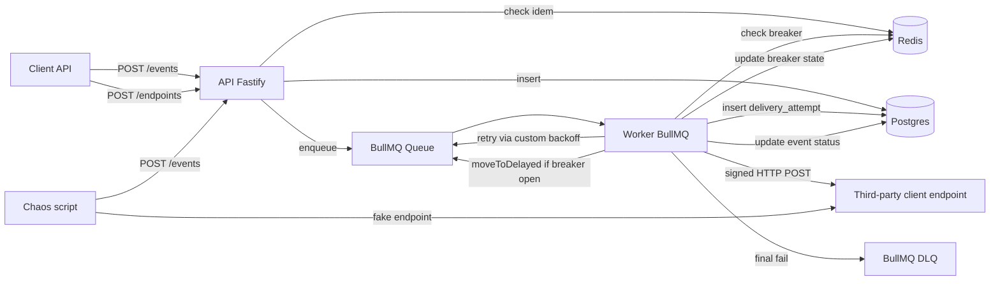

# Webhook Delivery Service — Hot Path V1

**Date**: 2026-05-09
**Status**: Draft (awaiting review)
**Author**: brainstormed via Claude Code
**Scope**: first spec of a multi-spec project. The Next.js dashboard, the Rust port + benchmark, and the AWS CDK migration each get their own later spec.

---

## 1. Goals and non-goals

### Why this project exists

Node/TypeScript backend service that ingests events through an HTTP API and delivers them to third-party client endpoints, with exponential retry, circuit breaker, idempotency keys and manual replay. Multi-tenant (each client has its own API key and endpoints), API model aligned with [Standard Webhooks](https://www.standardwebhooks.com) (Svix / Resend / Knock).

### Explicit goals

1. **Demonstrate distributed backend skills for a senior interview** — the core topics (retry, DLQ, circuit breaker, idempotency, HMAC signature) are exactly the ones a senior recruiter will want to dig into.
2. **Serve as the base for the later Node-vs-Rust benchmark** — the hot path must be representative enough for the comparison to be meaningful.
3. **Produce technical content material** (blog post, talk) — the chaos script that generates a recovery PNG is the central narrative artifact.

### Non-goals (deliberately excluded)

- Serving real customers in production. Not a product, a showcase project.
- Covering production-grade observability (Prometheus, Grafana, OpenTelemetry).
- Covering a broad functional scope (dashboard, SDK, consumer-side helpers, multi-region) — see later specs.
- Optimizing for raw performance — that's the job of the future Rust port.

### Exit criteria (Definition of Done V1)

- All API routes specified in section 3 implemented and compliant.
- Unit + integration test suite green.
- Chaos script `pnpm demo:chaos` that runs end-to-end and produces a PNG in `docs/chaos-runs/`.
- Service deployed on Fly.io + Neon + Upstash, reachable via a public URL.
- README with: description, Standard Webhooks link, local run instructions, most recent chaos run PNG embedded, "Out of scope V1" section reproduced verbatim from this spec.
- CI green on `main` (typecheck + lint + unit + integration).

---

## 2. Architecture



### Components

- **Fastify API** — a single process. Ingestion (`POST /events`), endpoint CRUD, replay, reads. Auth via bearer API key.
- **BullMQ Worker** — a separate process (same Docker image, different entrypoint). Picks up jobs, checks the breaker, hits the endpoint, writes the audit log, handles retry/DLQ via BullMQ's custom backoff.
- **Postgres** — durable source of truth: `clients`, `endpoints`, `events`, `delivery_attempts`. Queryable audit log.
- **Redis** — volatile shared state: per-endpoint breaker state, idempotency cache, BullMQ queue (jobs + delays + DLQ).
- **Chaos script** — standalone Node process, launched via `pnpm demo:chaos`. Not a production component.

### Process partitioning

API and Worker are separate processes (not a single one) so each can scale independently and to make the ingestion / delivery decoupling concrete. In local dev, `pnpm dev` runs both via `concurrently`.

### Repo layout

```
vitrine/
├── apps/
│   ├── api/              # Fastify HTTP server
│   └── worker/           # BullMQ worker
├── packages/
│   ├── core/             # Zod types, signWebhook, breaker FSM, retry policy, encryption
│   ├── db/               # Drizzle schema + migrations
│   └── queue/            # BullMQ wrapper + Lua script helpers
├── scripts/
│   ├── chaos-demo.ts     # demo script
│   └── cli/              # pnpm cli:create-client, etc.
├── docs/
│   ├── chaos-runs/       # generated PNGs
│   └── superpowers/specs/# design + plan
├── docker-compose.yml          # dev
├── docker-compose.demo.yml     # chaos demo
├── Dockerfile                  # multi-stage, image shared by API+Worker
└── fly.toml
```

pnpm workspace with `pnpm-workspace.yaml`.

---

## 3. Public API

### Auth convention

Header `Authorization: Bearer cl_secret_<base64-32bytes>` on all routes except `/health` and `/ready`. No public signup in V1 — clients are created via a local CLI (`pnpm cli:create-client --name <...>`) that inserts into Postgres and prints the plaintext secret only once.

### ID convention

Prefixed ULID: `cl_<ulid>` for clients, `ep_<ulid>` for endpoints, `evt_<ulid>` for events, `da_<ulid>` for delivery_attempts. Time-sortable, readable, aligned with Stripe/Svix.

### Routes

| Method | Path | Role |
|---|---|---|
| `POST` | `/events` | Ingestion. `Idempotency-Key` required. |
| `POST` | `/events/:id/replay` | Replay single event. |
| `GET` | `/events` | List with `status`, `endpoint_id` filters, cursor pagination. |
| `GET` | `/events/:id` | Detail + all `delivery_attempts`. |
| `POST` | `/endpoints` | Creates an endpoint, returns the secret only once. |
| `GET` | `/endpoints` | List (without secret). |
| `PATCH` | `/endpoints/:id` | Updates url or description (not the secret). |
| `DELETE` | `/endpoints/:id` | Soft delete (`archived_at`). |
| `GET` | `/health` | Liveness, no auth. |
| `GET` | `/ready` | Postgres + Redis ping, no auth. |

### `POST /events` — detail

```http
POST /events
Authorization: Bearer cl_secret_<...>
Idempotency-Key: order_42_shipped_v1
Content-Type: application/json

{
  "endpoint_id": "ep_01HZ...",
  "event_type": "order.shipped",
  "payload": { ... arbitrary JSON, max 1 MB ... }
}
```

Zod validation:
- `endpoint_id`: ULID prefixed with `ep_`.
- `event_type`: regex `^[a-z]+(\.[a-z]+)*$`.
- `payload`: JSON, size ≤ 1 MB after serialization.

Responses:
- `202 Accepted` (creation) or `200 OK` (idempotency hit, same `event_id` returned):
  ```json
  { "id": "evt_01HZ...", "status": "pending", "endpoint_id": "ep_01HZ...", "created_at": "..." }
  ```
- `400`: missing `Idempotency-Key`, invalid payload, payload > 1 MB.
- `401`: invalid or missing API key.
- `404`: `endpoint_id` doesn't belong to the current client or is archived.
- `422`: `{ "error": "idempotency_conflict" }` — same `Idempotency-Key`, different payload.

### `GET /events/:id` — detail

```json
{
  "id": "evt_01HZ...",
  "endpoint_id": "ep_01HZ...",
  "event_type": "order.shipped",
  "payload": { ... },
  "status": "delivered",
  "created_at": "...",
  "delivered_at": "...",
  "attempts": [
    {
      "attempt_number": 1,
      "attempted_at": "...",
      "status_code": 502,
      "duration_ms": 1234,
      "error_class": "http_5xx",
      "response_body_excerpt": "Bad Gateway..."
    },
    { "attempt_number": 2, "attempted_at": "...", "status_code": 200, "duration_ms": 87, "error_class": null }
  ]
}
```

### Out of V1

- Endpoint secret rotation (`POST /endpoints/:id/rotate-secret`).
- Batch replay (`POST /endpoints/:id/replay?since=...`).
- Prometheus metrics (`/metrics`).

---

## 4. Data model

### Postgres

```sql
CREATE TABLE clients (
  id            TEXT PRIMARY KEY,                    -- cl_<ulid>
  name          TEXT NOT NULL,
  api_key_hash  TEXT NOT NULL UNIQUE,                -- argon2id(bearer_token)
  created_at    TIMESTAMPTZ NOT NULL DEFAULT NOW()
);

CREATE TABLE endpoints (
  id                TEXT PRIMARY KEY,                -- ep_<ulid>
  client_id         TEXT NOT NULL REFERENCES clients(id) ON DELETE CASCADE,
  url               TEXT NOT NULL,
  secret_encrypted  BYTEA NOT NULL,                  -- AES-256-GCM (iv ‖ tag ‖ ciphertext)
  description       TEXT,
  archived_at       TIMESTAMPTZ,
  created_at        TIMESTAMPTZ NOT NULL DEFAULT NOW()
);
CREATE INDEX endpoints_client_active_idx
  ON endpoints(client_id) WHERE archived_at IS NULL;

CREATE TABLE events (
  id            TEXT PRIMARY KEY,                    -- evt_<ulid>
  endpoint_id   TEXT NOT NULL REFERENCES endpoints(id),
  event_type    TEXT NOT NULL,
  payload       JSONB NOT NULL,
  status        TEXT NOT NULL CHECK (status IN ('pending','delivered','dead')),
  delivered_at  TIMESTAMPTZ,
  dead_at       TIMESTAMPTZ,
  created_at    TIMESTAMPTZ NOT NULL DEFAULT NOW()
);
CREATE INDEX events_endpoint_status_idx
  ON events(endpoint_id, status, created_at DESC);

CREATE TABLE delivery_attempts (
  id                     TEXT PRIMARY KEY,           -- da_<ulid>
  event_id               TEXT NOT NULL REFERENCES events(id) ON DELETE CASCADE,
  attempt_number         INT NOT NULL,
  attempted_at           TIMESTAMPTZ NOT NULL DEFAULT NOW(),
  status_code            INT,                        -- NULL on timeout/network error
  duration_ms            INT NOT NULL,
  error_class            TEXT,                       -- 'http_5xx' | 'http_4xx' | 'timeout' | 'network' | 'throttle' | NULL on success
  response_body_excerpt  TEXT,                       -- first 1000 chars
  UNIQUE(event_id, attempt_number)
);
```

### Redis

| Key pattern | Value | TTL | Mutation |
|---|---|---|---|
| `breaker:{endpoint_id}` | JSON `{state, opened_at, fail_count, open_duration_ms}` | 24h (cleanup only — the logical `open → half_open` transition is computed on read via `opened_at + open_duration_ms ≤ now`) | Lua script `record_outcome.lua` |
| `breaker:{endpoint_id}:probe_lock` | `1` | 5s | `SET NX EX 5` when a worker attempts the probe in `half_open` |
| `breaker:skip_count:{endpoint_id}` | INT | 1h | `INCR` on every skip for visibility |
| `idem:{client_id}:{key}` | JSON `{event_id, payload_sha256}` | 24h | `SET NX EX 86400` at ingestion |
| `bull:webhook-deliveries:*` | (BullMQ internal) | (managed by BullMQ) | (managed by BullMQ) |

### Notable decisions

- **`api_key_hash` with argon2id**, not bcrypt. Modern standard (PHC winner), GPU-resistant. OWASP params: memory 19 MiB, iterations 2, parallelism 1.
- **`secret_encrypted` via envelope encryption**: AES-256-GCM, master key via env `MASTER_ENCRYPTION_KEY` (32 bytes base64), format `iv (12 bytes) ‖ tag (16 bytes) ‖ ciphertext`. Decrypted on the fly by the worker (~10 µs, negligible). In a future prod setup, the master key would move to AWS KMS.
- **No `delivery_attempts` row when the breaker skips**: the audit log captures real HTTP attempts, not non-attempts. Skip visibility via `breaker:skip_count:{endpoint_id}` and structured Pino logs.
- **`response_body_excerpt` truncated to 1000 characters**: otherwise a heavy HTML 5xx response blows up the table.
- **No soft-delete on events**: immutable audit log. Only `endpoints` has `archived_at`.

---

## 5. Delivery mechanics

### Ingestion flow (`POST /events`)

```
1. Auth bearer token → client_id (lookup api_key_hash via argon2.verify)
2. Validate body (Zod)
3. Check ownership: endpoint_id belongs to client_id and archived_at IS NULL
4. Compute payload_sha256, generate evt_ULID
5. SET NX idem:{client_id}:{key} {event_id, payload_sha256} EX 86400
   ├── failed: GET idem
   │   ├── payload_sha256 match  → 200, return existing event_id (no DB write)
   │   └── payload_sha256 differ → 422 idempotency_conflict
   └── succeeded: continue
6. INSERT event (status=pending)
7. Enqueue BullMQ job {event_id} (no delay, attempts=7, custom backoff)
8. 202 Accepted
```

**Documented edge case**: crash between step 5 and 6 → the idem key points to an `event_id` with no DB row. Self-heals after 24h when the key expires. Documented in the README "known limitations". Acceptable for V1, fixable in V2 via a compensating INSERT.

### Delivery flow (worker)

```
1. Worker picks up job {event_id} from BullMQ
2. SELECT event JOIN endpoint, decrypt endpoint.secret_encrypted
3. Read breaker state via GET breaker:{endpoint_id}:
   - key absent                                            → closed
   - state=open AND opened_at + open_duration_ms > now     → open
   - state=open AND opened_at + open_duration_ms ≤ now     → half_open (lazy transition on read)
   - state=half_open                                       → half_open
   ├── open       : job.moveToDelayed(opened_at + open_duration_ms - now)
   │                → no attempt counted, no delivery_attempts row
   ├── half_open  : SET NX breaker:{ep}:probe_lock EX 5
   │                ├── lock failed   : moveToDelayed(1s)
   │                └── lock acquired : this job is the probe, continue
   └── closed     : continue
4. POST endpoint.url
   - Headers: webhook-id, webhook-timestamp, webhook-signature, content-type
   - Body: JSON(event.payload)
   - Timeout: 10s
5. Classify outcome:
   • 2xx/3xx        → success
   • 5xx            → http_5xx (retry)
   • 4xx (non-429)  → http_4xx (straight to DLQ, no retry)
   • 429            → throttle (retry, honor Retry-After if present and reasonable)
   • timeout        → timeout (retry)
   • network/DNS/TLS → network (retry)
6. INSERT delivery_attempts (status_code, duration_ms, error_class, response_body_excerpt)
7. Lua record_outcome.lua → new breaker state (atomic)
8. Update event.status:
   • success     → delivered, delivered_at = NOW()
   • http_4xx    → dead, dead_at = NOW()
   • retry-able + attemptsMade < 7 → throw retryable error → BullMQ reschedule via custom backoff
   • retry-able + attemptsMade == 7 → dead, dead_at = NOW(), job goes to BullMQ DLQ
```

**`job.moveToDelayed` when the breaker is open**: doesn't consume a BullMQ attempt. A delivery postponed by the breaker is not a failed delivery.

**5s probe lock in `half_open`**: without a lock, N parallel workers hit the endpoint simultaneously in half_open. The lock guarantees a single probe per 5s window. Other workers requeue with 1s.

### Retry policy

| Attempt | Delay before attempt |
|---|---|
| 1 (initial) | 0 |
| 2 | 1 s ± 20% |
| 3 | 10 s ± 20% |
| 4 | 1 min ± 20% |
| 5 | 10 min ± 20% |
| 6 | 1 h ± 20% |
| 7 | 6 h ± 20% |

Total **time-to-dead** (worst case, constant failures): `1 + 10 + 60 + 600 + 3600 + 21600 = 25871 s ≈ 7h11` ± jitter.

**Multiplicative ±20% jitter**: `actual_delay = base × (0.8 + random() × 0.4)`. Prevents the thundering herd when an endpoint comes back to 200 with N events waiting.

**BullMQ implementation**: `attempts: 7`, `backoff: { type: 'custom' }`, and the custom function looks at `attemptsMade` to return the delay from the table above with jitter.

**429 + Retry-After**: if the header is present and its value is ≤ 6h, we use `max(Retry-After, base_delay)` for that attempt — we honor at least what the endpoint asks for, without going below our schedule. The retry counter doesn't advance specially: the next attempt resumes from the normal scheduled delay. If the header is absent or nonsensical (> 6h or non-numeric), normal schedule.

**Non-429 4xx → straight to DLQ**: a 400/401/404 indicates a client config problem (wrong URL, rotated secret, deleted route). Spamming 7 retries over 7h won't fix it.

### Circuit breaker — state machine

State stored as JSON in `breaker:{endpoint_id}`:
```json
{ "state": "closed" | "open" | "half_open",
  "opened_at": <timestamp_ms> | null,
  "fail_count": <int>,
  "open_duration_ms": <int> }
```

**Definition of a failure**:
- `5xx` → failure.
- Timeout (>10s) → failure.
- Network error (DNS, TCP reset, TLS) → failure.
- `429` → failure (with Retry-After honored separately for scheduling).
- Non-429 `4xx` → **not a breaker failure**. Straight to DLQ.
- `2xx` / `3xx` → success.

**Transitions**:

| State | Event | New state | Effect |
|---|---|---|---|
| closed | failure, fail_count=4 | closed | INCR fail_count → 5 |
| closed | failure, fail_count=5 (post-incr) | open | opened_at=NOW, open_duration_ms=30000, fail_count=0 |
| closed | success | closed | fail_count=0 |
| open | `opened_at + open_duration_ms ≤ now` (lazy on read) | half_open | logical transition only, persisted on next write |
| half_open | success (probe) | closed | fail_count=0, open_duration_ms reset to 30000 |
| half_open | failure (probe) | open | opened_at=NOW, open_duration_ms=min(open_duration_ms × 2, 1_800_000) |

**Cap**: `open_duration_ms` capped at 30 min (1,800,000 ms).

**Atomicity**: the transition is performed by a single Lua script `record_outcome.lua` that takes `(endpoint_id, outcome)` and returns the post-transition state. Prevents races between N concurrent workers finishing a delivery to the same endpoint at the same time.

### Replay flow

```
POST /events/:id/replay (auth, ownership)
1. SELECT event; 404 if missing or not owned by the client
2. Check status:
   • pending  → 409 Conflict (already in progress)
   • delivered → continue
   • dead     → continue
3. UPDATE event SET status='pending', delivered_at=NULL, dead_at=NULL
4. Enqueue {event_id} (no delay)
5. 200 OK
```

The worker handles the job like any other. `attempt_number` continues at `max(attempt_number) + 1` — the audit log accumulates, never resets. The `event_id` stays the same → consumer-side `webhook-id` stays the same → consumer-side dedup is trivial.

The breaker is honored (replaying to an `open` endpoint is moveToDelayed like a normal delivery).

### DLQ flow

Minimalist V1: no notification, no auto-replay. The DLQ exists in two forms:

1. **Postgres** (canonical): `status='dead'` in `events`. Queryable via `GET /events?status=dead`.
2. **BullMQ DLQ** (dev convenience): failed jobs stay in Redis for inspection via Bull Board in dev. In prod (Fly.io), 7-day retention.

The client acts manually: `GET /events?status=dead`, inspects, decides endpoint by endpoint whether to replay or abandon.

---

## 6. Security

### Public API auth (inbound)

- Header `Authorization: Bearer cl_secret_<base64-32bytes>`.
- Token randomly generated at client creation (CLI), returned ONLY once.
- Stored hashed: `clients.api_key_hash = argon2id(token, params_owasp)`.
- Verified via `argon2.verify(hash, token)` — constant-time on the lib side.
- No TTL on the API key in V1; rotation = recreate a client.

### Outbound signature (Standard Webhooks)

- Headers: `webhook-id`, `webhook-timestamp` (unix seconds), `webhook-signature: v1,<base64>`.
- Signed string: `<id>.<timestamp>.<raw_body>`.
- Algo: HMAC-SHA256, base64 output.
- The `v1,<sig>` format allows versioning if the algorithm changes.
- Link to the official spec: https://www.standardwebhooks.com.

### Endpoint secrets at rest

- Storage format: `iv (12 bytes) ‖ tag (16 bytes) ‖ ciphertext`, as BYTEA.
- Algo: AES-256-GCM via Node `crypto`.
- Master key: env var `MASTER_ENCRYPTION_KEY` (32 bytes in base64), injected via Fly.io secrets in prod, via `.env` in dev.
- Decrypted on the fly by the worker. No plaintext cache.

### Out of V1

Rate limiting on `POST /events`, endpoint secret rotation, signed cookies / OAuth, admin audit log, per-client IP allowlist.

---

## 7. Tests and chaos demo

### Level 1 — Unit (Vitest, no I/O)

Targets:
- `backoff(attempt, jitter_ratio = 0.2)` → schedule + jitter range.
- `signWebhook(secret, id, timestamp, body)` → test vectors from https://github.com/standard-webhooks/standard-webhooks.
- `breakerTransition(currentState, outcome)` → state machine as a truth table (16+ cases).
- `idempotencyDecide(stored, incoming)` → payload match / mismatch / absent.
- `classifyOutcome(httpResponse | error)` → maps to `success | http_5xx | http_4xx | timeout | network | throttle`.
- `parseRetryAfter(header)` → numeric seconds or HTTP date, range check.

### Level 2 — Integration (Vitest + Testcontainers)

**Shared setup**: fixture that spins up Postgres + Redis + a local fake Fastify endpoint on a random port, with an API to make it respond 200/500/timeout/etc on demand.

**Covered cases** (one test per row):

| Category | Case |
|---|---|
| Happy path | Event ingested → delivered on first try, status=delivered, 1 attempt row |
| Successful retry | 5xx ×3 then 200 → delivered, 4 attempt rows |
| DLQ | 5xx ×7 → status=dead, 7 rows, job in BullMQ DLQ |
| Breaker open | 5 consecutive 5xx events → breaker open, 6th event requeued without an HTTP call |
| Breaker recovery | Open → TTL expires → half_open → probe 200 → closed |
| Breaker re-open | Half_open + probe 5xx → open with doubled duration |
| Replay dead | Replay of a dead event → re-enqueue → delivered with attempt_number=8 |
| Replay delivered | Allowed |
| Replay pending | 409 Conflict |
| Idempotency hit | Same key + same payload → 200, existing event_id, only 1 event in DB |
| Idempotency conflict | Same key + different payload → 422 |
| Missing idem key | 400 |
| 4xx → DLQ | 401 → status=dead immediately, 1 attempt row, no retry |
| 429 + Retry-After | Header honored, next attempt at the Retry-After time |
| Auth | Missing/invalid bearer → 401 |
| Cross-client | Client A tries an event to client B's endpoint → 404 |
| Endpoint archived | POST event to a soft-deleted endpoint → 404 |

### Level 3 — Chaos demo (`pnpm demo:chaos`)

Standalone script `scripts/chaos-demo.ts`:

```
1. Spin up the stack via docker-compose.demo.yml (Postgres + Redis + service)
2. Start a local fake endpoint that follows this scenario (configurable durations):
   - Phase 1 (0-10s): stable 200
   - Phase 2 (10-40s): hard 500 (outage)
   - Phase 3 (40-80s): 50% 500 / 50% 200 (chaotic recovery)
   - Phase 4 (80s+): stable 200
3. Push 100 events over 5s via POST /events
4. Console tail at 1 Hz: delivered/pending/dead, breaker_state, P50/P99 latency
5. At the end: generate a PNG via chartjs-node-canvas with:
   - Cumulative delivery rate over time
   - Annotations for phases 1-4
   - Breaker open/half_open/closed markers
6. Save to docs/chaos-runs/YYYY-MM-DD-HH-MM.png
7. Print the PNG path, ready to be committed
```

The most recent PNG goes in the README. It's the artifact that makes the project readable in 10 seconds for a recruiter.

### CI

GitHub Actions on `main` and PRs:
- `pnpm typecheck` (`tsc --noEmit`)
- `pnpm lint` (Biome)
- `pnpm test:unit`
- `pnpm test:integration` (Testcontainers — GitHub-hosted runner has Docker)

`pnpm demo:chaos` is not in CI (long, run manually for the README).

---

## 8. Tech stack

| Layer | Choice | Target version |
|---|---|---|
| Runtime | Node.js | 22 LTS |
| Package manager | pnpm | 9.x |
| TypeScript | tsc strict | 5.x |
| API | Fastify | 5.x |
| Validation | Zod | 3.x (4 if stable at implementation time) |
| ORM + migrations | Drizzle ORM + drizzle-kit | latest |
| Postgres driver | postgres-js | latest |
| Queue | BullMQ | 5.x |
| Redis client | ioredis | 5.x |
| HTTP client (worker) | undici | latest (built into Node 22) |
| Logging | Pino | 9.x |
| Crypto | Native Node `crypto` + `@node-rs/argon2` | |
| ID generation | `ulid` | 2.x |
| Tests | Vitest | 2.x |
| Testcontainers | `@testcontainers/postgresql`, `@testcontainers/redis` | latest |
| Chaos PNG | `chartjs-node-canvas` | latest |
| Linter / formatter | Biome | latest |

**pnpm workspace** with `pnpm-workspace.yaml`. Build via `tsup` (fast).

---

## 9. Deployment

### V1 target

| Component | Platform | Target cost/month |
|---|---|---|
| API process | Fly.io machine `shared-cpu-1x / 256MB` × 1 | ~€2 |
| Worker process | Fly.io machine `shared-cpu-1x / 512MB` × 1 | ~€3 |
| Postgres | Neon Free tier (0.5 GB) | €0 |
| Redis | Upstash Free tier (10K cmds/day, 256 MB) | €0 |
| **Total** | | **~€5/month** |

### Rationale

- **Fly.io rather than Railway/Render**: infra-as-code config via `fly.toml`, Docker-first narrative, generous free tier for a showcase project.
- **Neon rather than Fly Postgres**: decoupled from the compute layer, DB branching for ephemeral integration tests.
- **Upstash rather than Fly Redis**: pay-per-request, the free 10K cmds/day is enough for the demo.
- **No AWS in V1** — explicitly deferred to the "AWS CDK migration" spec.

### Docker image

Multi-stage Dockerfile, single final image. Entrypoint configured at Fly deploy time:
- API: `CMD ["node", "apps/api/dist/server.js"]`
- Worker: `CMD ["node", "apps/worker/dist/worker.js"]`

Two distinct Fly services (parent `fly.toml` + per-process configs) or two distinct Fly apps.

### CI/CD

GitHub Actions triggers `flyctl deploy` on push to `main`, with automatic Drizzle migrations (`drizzle-kit push` run before boot via Fly `release_command`).

### Environment variables

| Variable | Source | Value |
|---|---|---|
| `DATABASE_URL` | Fly secrets | Neon URL |
| `REDIS_URL` | Fly secrets | Upstash URL |
| `MASTER_ENCRYPTION_KEY` | Fly secrets | 32 bytes base64 generated once |
| `LOG_LEVEL` | Fly env | `info` (prod), `debug` (dev) |
| `PORT` | Fly env | `3000` |
| `NODE_ENV` | Fly env | `production` |

All secrets via `flyctl secrets set` (never in `fly.toml`).

---

## 10. Out of scope V1

Documented in the README so a recruiter sees it's *chosen*, not forgotten.

- No public client signup — creation via local CLI.
- No endpoint secret rotation — delete + recreate.
- No batch replay — single event only.
- No DLQ notifications (email, Slack, out-of-band webhook).
- No production-grade observability — Pino structured logs only.
- No rate limiting on the public API.
- No client SDKs or consumer-side signature verification helper.
- No Rust port — separate spec.
- No Next.js dashboard — separate spec.
- No AWS CDK migration — separate spec.
- Race-window edge case between Redis SET NX and Postgres INSERT — documented, accepted for V1, fixable in V2.
- No multi-region support — single Fly region (cdg or par1).
- No soft-delete cascade on events when an endpoint is archived — events remain.

---

## Appendix — open questions for the plan phase

To be handled in the implementation plan, not in the design:

- Exact choice of argon2id params (memory, iterations, parallelism) — depends on the target Fly machine.
- BullMQ custom backoff function: exposed via `WorkerOptions` or via an override of `Worker.processJob`?
- Testcontainers fixture seeding strategy: raw SQL or Drizzle insert?
- Exact sub-package layout (can `packages/core` stay a single package, or should it be split further?) — decided when writing the plan.
- `chartjs-node-canvas` or a lighter alternative? Evaluate when writing the chaos script.
- Postgres `JSONB` vs `JSON` for `events.payload`? Probably JSONB for future filters, to be confirmed.
- BullMQ concurrency per worker (default 1, can go up to 10 on a 512 MB machine).

---

## Backlinks

- Original idea: see brainstorming conversation 2026-05-09.
- Planned later specs: `dashboard-nextjs`, `workers-rust-benchmark`, `aws-cdk-migration`.
