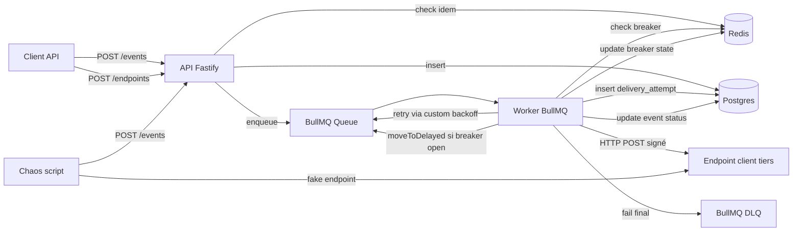

# Webhook Delivery Service — Hot Path V1

**Date** : 2026-05-09
**Statut** : Draft (en attente de relecture)
**Auteur** : brainstormé via Claude Code
**Périmètre** : premier spec d'un projet multi-specs. Le dashboard Next.js, le port Rust + benchmark, et la migration AWS CDK sont chacun leur propre spec ultérieur.

---

## 1. Objectifs et non-objectifs

### Pourquoi ce projet existe

Service backend Node/TypeScript qui ingère des événements via une API HTTP et les livre à des endpoints clients tiers, avec retry exponentiel, circuit breaker, idempotency keys et replay manuel. Multi-tenant (chaque client a sa propre API key et ses endpoints), modèle d'API aligné sur [Standard Webhooks](https://www.standardwebhooks.com) (Svix / Resend / Knock).

### Objectifs explicites

1. **Démontrer une compétence backend distribuée pour entretien senior** — les sujets centraux (retry, DLQ, circuit breaker, idempotency, signature HMAC) sont précisément ceux qu'un recruteur senior va vouloir creuser.
2. **Servir de base au benchmark Node-vs-Rust ultérieur** — le hot path doit être suffisamment représentatif pour que la comparaison ait du sens.
3. **Produire du matériau de contenu technique** (blog post, talk) — le chaos script qui génère un PNG de récupération est l'artefact narratif central.

### Non-objectifs (volontairement exclus)

- Servir de vrais clients en production. Pas un produit, un projet vitrine.
- Couvrir l'observabilité production-grade (Prometheus, Grafana, OpenTelemetry).
- Couvrir un large périmètre fonctionnel (dashboard, SDK, helpers consumer-side, multi-region) — voir specs ultérieurs.
- Optimiser pour la performance pure — c'est le rôle du futur port Rust.

### Critères de fin (Definition of Done V1)

- Toutes les routes API spécifiées en section 3 implémentées et conformes.
- Suite de tests unit + integration verte.
- Chaos script `pnpm demo:chaos` qui run end-to-end et produit un PNG dans `docs/chaos-runs/`.
- Service déployé sur Fly.io + Neon + Upstash, accessible via URL publique.
- README avec : description, lien Standard Webhooks, instructions de run local, PNG chaos run le plus récent embedé, section "Out of scope V1" reproduite verbatim depuis ce spec.
- CI verte sur `main` (typecheck + lint + unit + integration).

---

## 2. Architecture



### Composants

- **API Fastify** — un seul process. Ingestion (`POST /events`), endpoint CRUD, replay, lecture. Auth via API key bearer.
- **Worker BullMQ** — un process séparé (même image Docker, entrypoint différent). Pioche les jobs, vérifie le breaker, tape l'endpoint, écrit l'audit log, gère retry/DLQ via le custom backoff de BullMQ.
- **Postgres** — source de vérité durable : `clients`, `endpoints`, `events`, `delivery_attempts`. Audit log queryable.
- **Redis** — état partagé volatile : breaker state per endpoint, idempotency cache, BullMQ queue (jobs + delays + DLQ).
- **Chaos script** — process Node standalone, lancé via `pnpm demo:chaos`. Pas un composant de prod.

### Partitionnement processus

API et Worker sont des processus séparés (pas un seul) pour permettre de scale l'un sans l'autre et matérialiser le découplage ingestion / livraison. En dev local, `pnpm dev` lance les deux via `concurrently`.

### Layout du repo

```
vitrine/
├── apps/
│   ├── api/              # Fastify HTTP server
│   └── worker/           # BullMQ worker
├── packages/
│   ├── core/             # types Zod, signWebhook, breaker FSM, retry policy, encryption
│   ├── db/               # Drizzle schema + migrations
│   └── queue/            # wrapper BullMQ + helpers Lua scripts
├── scripts/
│   ├── chaos-demo.ts     # script demo
│   └── cli/              # pnpm cli:create-client, etc.
├── docs/
│   ├── chaos-runs/       # PNG générés
│   └── superpowers/specs/# design + plan
├── docker-compose.yml          # dev
├── docker-compose.demo.yml     # chaos demo
├── Dockerfile                  # multi-stage, image partagée API+Worker
└── fly.toml
```

Workspace pnpm avec `pnpm-workspace.yaml`.

---

## 3. API publique

### Convention d'auth

Header `Authorization: Bearer cl_secret_<base64-32bytes>` sur toutes les routes sauf `/health` et `/ready`. Pas de signup public dans V1 — les clients sont créés via CLI locale (`pnpm cli:create-client --name <...>`) qui insère dans Postgres et imprime le secret en clair une seule fois.

### Convention d'IDs

ULID préfixé : `cl_<ulid>` pour clients, `ep_<ulid>` pour endpoints, `evt_<ulid>` pour events, `da_<ulid>` pour delivery_attempts. Sortable par temps, lisible, aligné sur Stripe/Svix.

### Routes

| Méthode | Path | Rôle |
|---|---|---|
| `POST` | `/events` | Ingestion. `Idempotency-Key` requis. |
| `POST` | `/events/:id/replay` | Replay single event. |
| `GET` | `/events` | Liste avec filtres `status`, `endpoint_id`, cursor pagination. |
| `GET` | `/events/:id` | Détail + tous les `delivery_attempts`. |
| `POST` | `/endpoints` | Crée un endpoint, retourne le secret une seule fois. |
| `GET` | `/endpoints` | Liste (sans secret). |
| `PATCH` | `/endpoints/:id` | Modifie url ou description (pas le secret). |
| `DELETE` | `/endpoints/:id` | Soft delete (`archived_at`). |
| `GET` | `/health` | Liveness, sans auth. |
| `GET` | `/ready` | Postgres + Redis ping, sans auth. |

### `POST /events` — détail

```http
POST /events
Authorization: Bearer cl_secret_<...>
Idempotency-Key: order_42_shipped_v1
Content-Type: application/json

{
  "endpoint_id": "ep_01HZ...",
  "event_type": "order.shipped",
  "payload": { ... arbitrary JSON, max 1 MB ... }
}
```

Validation Zod :
- `endpoint_id` : ULID préfixé `ep_`.
- `event_type` : regex `^[a-z]+(\.[a-z]+)*$`.
- `payload` : JSON, taille ≤ 1 MB après serialization.

Réponses :
- `202 Accepted` (création) ou `200 OK` (idempotency hit, même `event_id` retourné) :
  ```json
  { "id": "evt_01HZ...", "status": "pending", "endpoint_id": "ep_01HZ...", "created_at": "..." }
  ```
- `400` : `Idempotency-Key` manquant, payload invalide, payload > 1 MB.
- `401` : API key invalide ou manquante.
- `404` : `endpoint_id` n'appartient pas au client courant ou archived.
- `422` : `{ "error": "idempotency_conflict" }` — même `Idempotency-Key`, payload différent.

### `GET /events/:id` — détail

```json
{
  "id": "evt_01HZ...",
  "endpoint_id": "ep_01HZ...",
  "event_type": "order.shipped",
  "payload": { ... },
  "status": "delivered",
  "created_at": "...",
  "delivered_at": "...",
  "attempts": [
    {
      "attempt_number": 1,
      "attempted_at": "...",
      "status_code": 502,
      "duration_ms": 1234,
      "error_class": "http_5xx",
      "response_body_excerpt": "Bad Gateway..."
    },
    { "attempt_number": 2, "attempted_at": "...", "status_code": 200, "duration_ms": 87, "error_class": null }
  ]
}
```

### Hors V1

- Rotation de secret endpoint (`POST /endpoints/:id/rotate-secret`).
- Batch replay (`POST /endpoints/:id/replay?since=...`).
- Métriques Prometheus (`/metrics`).

---

## 4. Modèle de données

### Postgres

```sql
CREATE TABLE clients (
  id            TEXT PRIMARY KEY,                    -- cl_<ulid>
  name          TEXT NOT NULL,
  api_key_hash  TEXT NOT NULL UNIQUE,                -- argon2id(bearer_token)
  created_at    TIMESTAMPTZ NOT NULL DEFAULT NOW()
);

CREATE TABLE endpoints (
  id                TEXT PRIMARY KEY,                -- ep_<ulid>
  client_id         TEXT NOT NULL REFERENCES clients(id) ON DELETE CASCADE,
  url               TEXT NOT NULL,
  secret_encrypted  BYTEA NOT NULL,                  -- AES-256-GCM (iv ‖ tag ‖ ciphertext)
  description       TEXT,
  archived_at       TIMESTAMPTZ,
  created_at        TIMESTAMPTZ NOT NULL DEFAULT NOW()
);
CREATE INDEX endpoints_client_active_idx
  ON endpoints(client_id) WHERE archived_at IS NULL;

CREATE TABLE events (
  id            TEXT PRIMARY KEY,                    -- evt_<ulid>
  endpoint_id   TEXT NOT NULL REFERENCES endpoints(id),
  event_type    TEXT NOT NULL,
  payload       JSONB NOT NULL,
  status        TEXT NOT NULL CHECK (status IN ('pending','delivered','dead')),
  delivered_at  TIMESTAMPTZ,
  dead_at       TIMESTAMPTZ,
  created_at    TIMESTAMPTZ NOT NULL DEFAULT NOW()
);
CREATE INDEX events_endpoint_status_idx
  ON events(endpoint_id, status, created_at DESC);

CREATE TABLE delivery_attempts (
  id                     TEXT PRIMARY KEY,           -- da_<ulid>
  event_id               TEXT NOT NULL REFERENCES events(id) ON DELETE CASCADE,
  attempt_number         INT NOT NULL,
  attempted_at           TIMESTAMPTZ NOT NULL DEFAULT NOW(),
  status_code            INT,                        -- NULL si timeout/network error
  duration_ms            INT NOT NULL,
  error_class            TEXT,                       -- 'http_5xx' | 'http_4xx' | 'timeout' | 'network' | 'throttle' | NULL si succès
  response_body_excerpt  TEXT,                       -- 1000 premiers chars
  UNIQUE(event_id, attempt_number)
);
```

### Redis

| Key pattern | Valeur | TTL | Mutation |
|---|---|---|---|
| `breaker:{endpoint_id}` | JSON `{state, opened_at, fail_count, open_duration_ms}` | 24h (cleanup uniquement — la transition logique `open → half_open` est calculée à la lecture via `opened_at + open_duration_ms ≤ now`) | Lua script `record_outcome.lua` |
| `breaker:{endpoint_id}:probe_lock` | `1` | 5s | `SET NX EX 5` quand un worker tente la probe en `half_open` |
| `breaker:skip_count:{endpoint_id}` | INT | 1h | `INCR` à chaque skip pour visibilité |
| `idem:{client_id}:{key}` | JSON `{event_id, payload_sha256}` | 24h | `SET NX EX 86400` à l'ingestion |
| `bull:webhook-deliveries:*` | (interne BullMQ) | (géré par BullMQ) | (géré par BullMQ) |

### Décisions notables

- **`api_key_hash` avec argon2id**, pas bcrypt. Standard moderne (lauréat PHC), résistant GPU. Params OWASP : memory 19 MiB, iterations 2, parallelism 1.
- **`secret_encrypted` via envelope encryption** : AES-256-GCM, master key via env `MASTER_ENCRYPTION_KEY` (32 bytes base64), format `iv (12 bytes) ‖ tag (16 bytes) ‖ ciphertext`. Décryption à la volée par le worker (~10 µs, négligeable). En prod future, master key migrerait vers AWS KMS.
- **Pas de ligne `delivery_attempts` quand le breaker skip** : l'audit log capture les tentatives HTTP réelles, pas les non-tentatives. Visibilité des skips via `breaker:skip_count:{endpoint_id}` et logs Pino structurés.
- **`response_body_excerpt` tronqué à 1000 caractères** : sinon une réponse 5xx HTML lourde explose la table.
- **Pas de soft-delete sur events** : audit log immuable. Seul `endpoints` a `archived_at`.

---

## 5. Mécanique de livraison

### Flow d'ingestion (`POST /events`)

```
1. Auth bearer token → client_id (lookup api_key_hash via argon2.verify)
2. Validate body (Zod)
3. Vérifier ownership : endpoint_id appartient à client_id et archived_at IS NULL
4. Compute payload_sha256, generate evt_ULID
5. SET NX idem:{client_id}:{key} {event_id, payload_sha256} EX 86400
   ├── failed: GET idem
   │   ├── payload_sha256 match  → 200, return existing event_id (no DB write)
   │   └── payload_sha256 differ → 422 idempotency_conflict
   └── succeeded: continue
6. INSERT event (status=pending)
7. Enqueue BullMQ job {event_id} (no delay, attempts=7, custom backoff)
8. 202 Accepted
```

**Edge case documenté** : crash entre étape 5 et 6 → idem key pointe vers un `event_id` sans ligne en DB. Self-heal après 24h via expiration de la key. Documenté dans le README "known limitations". Acceptable pour V1, fixable en V2 via INSERT compensatoire.

### Flow de livraison (worker)

```
1. Worker pioche job {event_id} depuis BullMQ
2. SELECT event JOIN endpoint, decrypt endpoint.secret_encrypted
3. Read breaker state via GET breaker:{endpoint_id} :
   - clé absente                                           → closed
   - state=open ET opened_at + open_duration_ms > now      → open
   - state=open ET opened_at + open_duration_ms ≤ now      → half_open (lazy transition à la lecture)
   - state=half_open                                       → half_open
   ├── open       : job.moveToDelayed(opened_at + open_duration_ms - now)
   │                → pas d'attempt comptée, pas de ligne delivery_attempts
   ├── half_open  : SET NX breaker:{ep}:probe_lock EX 5
   │                ├── lock failed   : moveToDelayed(1s)
   │                └── lock acquired : ce job est la probe, continue
   └── closed     : continue
4. POST endpoint.url
   - Headers : webhook-id, webhook-timestamp, webhook-signature, content-type
   - Body : JSON(event.payload)
   - Timeout : 10s
5. Classify outcome :
   • 2xx/3xx        → success
   • 5xx            → http_5xx (retry)
   • 4xx (non-429)  → http_4xx (DLQ direct, pas de retry)
   • 429            → throttle (retry, respect Retry-After si présent et raisonnable)
   • timeout        → timeout (retry)
   • network/DNS/TLS → network (retry)
6. INSERT delivery_attempts (status_code, duration_ms, error_class, response_body_excerpt)
7. Lua record_outcome.lua → nouvel état breaker (atomique)
8. Update event.status :
   • success     → delivered, delivered_at = NOW()
   • http_4xx    → dead, dead_at = NOW()
   • retry-able + attemptsMade < 7 → throw retryable error → BullMQ reschedule via custom backoff
   • retry-able + attemptsMade == 7 → dead, dead_at = NOW(), job va dans BullMQ DLQ
```

**`job.moveToDelayed` quand breaker open** : ne consomme pas d'attempt BullMQ. Une livraison reportée par le breaker n'est pas une livraison ratée.

**Probe lock 5s en `half_open`** : sans lock, N workers en parallèle frappent l'endpoint simultanément en half_open. Le lock garantit une seule probe par fenêtre de 5s. Les autres workers requeue avec 1s.

### Politique de retry

| Attempt | Délai avant tentative |
|---|---|
| 1 (initiale) | 0 |
| 2 | 1 s ± 20% |
| 3 | 10 s ± 20% |
| 4 | 1 min ± 20% |
| 5 | 10 min ± 20% |
| 6 | 1 h ± 20% |
| 7 | 6 h ± 20% |

**Time-to-dead** total (worst case, échecs constants) : `1 + 10 + 60 + 600 + 3600 + 21600 = 25871 s ≈ 7h11` ± jitter.

**Jitter ±20% multiplicatif** : `actual_delay = base × (0.8 + random() × 0.4)`. Empêche le thundering herd quand un endpoint revient à 200 avec N events en attente.

**Implémentation BullMQ** : `attempts: 7`, `backoff: { type: 'custom' }`, et la fonction custom regarde `attemptsMade` pour retourner le délai de la table ci-dessus avec jitter.

**429 + Retry-After** : si header présent et valeur ≤ 6h, on utilise `max(Retry-After, base_delay)` pour cette tentative — on respecte au minimum ce que l'endpoint demande, sans aller en-dessous de notre schedule. Le compteur de retry n'avance pas spécialement : la prochaine tentative repart du delay scheduled normal. Si header absent ou aberrant (> 6h ou non-numérique), schedule normal.

**4xx non-429 → DLQ direct** : un 400/401/404 indique un problème de config client (URL fausse, secret rotaté, route supprimée). Spammer 7 retries pendant 7h ne le réparera pas.

### Circuit breaker — state machine

État stocké en JSON dans `breaker:{endpoint_id}` :
```json
{ "state": "closed" | "open" | "half_open",
  "opened_at": <timestamp_ms> | null,
  "fail_count": <int>,
  "open_duration_ms": <int> }
```

**Définition d'un échec** :
- `5xx` → échec.
- Timeout (>10s) → échec.
- Network error (DNS, TCP reset, TLS) → échec.
- `429` → échec (avec respect Retry-After séparé pour le scheduling).
- `4xx` non-429 → **pas d'échec breaker**. DLQ direct.
- `2xx` / `3xx` → succès.

**Transitions** :

| État | Événement | Nouvel état | Effet |
|---|---|---|---|
| closed | échec, fail_count=4 | closed | INCR fail_count → 5 |
| closed | échec, fail_count=5 (post-incr) | open | opened_at=NOW, open_duration_ms=30000, fail_count=0 |
| closed | succès | closed | fail_count=0 |
| open | `opened_at + open_duration_ms ≤ now` (lazy à la lecture) | half_open | transition logique uniquement, persistée à la prochaine écriture |
| half_open | succès (probe) | closed | fail_count=0, open_duration_ms reset à 30000 |
| half_open | échec (probe) | open | opened_at=NOW, open_duration_ms=min(open_duration_ms × 2, 1_800_000) |

**Plafond** : `open_duration_ms` plafonné à 30 min (1 800 000 ms).

**Atomicité** : la transition est faite par un Lua script unique `record_outcome.lua` qui prend `(endpoint_id, outcome)` et retourne l'état post-transition. Empêche les races entre N workers concurrents qui finissent en même temps une livraison vers le même endpoint.

### Flow de replay

```
POST /events/:id/replay (auth, ownership)
1. SELECT event ; 404 si inexistant ou n'appartient pas au client
2. Vérifier status :
   • pending  → 409 Conflict (déjà en cours)
   • delivered → continue
   • dead     → continue
3. UPDATE event SET status='pending', delivered_at=NULL, dead_at=NULL
4. Enqueue {event_id} (no delay)
5. 200 OK
```

Le worker traite le job comme n'importe quel autre. `attempt_number` continue à `max(attempt_number) + 1` — l'audit log accumule, ne reset jamais. L'`event_id` reste le même → `webhook-id` côté consumer reste le même → dedup côté consumer triviale.

Le breaker est respecté (replay d'un endpoint en `open` est moveToDelayed comme une livraison normale).

### Flow DLQ

V1 minimaliste : pas de notification, pas d'auto-replay. La DLQ existe sous deux formes :

1. **Postgres** (canonique) : `status='dead'` dans `events`. Queryable via `GET /events?status=dead`.
2. **BullMQ DLQ** (dev convenience) : jobs failed restent en Redis pour inspection via Bull Board en dev. En prod (Fly.io), retention 7 jours.

Le client agit manuellement : `GET /events?status=dead`, examine, décide endpoint par endpoint si replay ou abandon.

---

## 6. Sécurité

### Auth API publique (inbound)

- Header `Authorization: Bearer cl_secret_<base64-32bytes>`.
- Token généré aléatoirement à la création client (CLI), retourné UNE seule fois.
- Stocké hashé : `clients.api_key_hash = argon2id(token, params_owasp)`.
- Vérification via `argon2.verify(hash, token)` — constant-time côté lib.
- Pas de TTL sur l'API key dans V1 ; rotation = recréer un client.

### Signature outbound (Standard Webhooks)

- Headers : `webhook-id`, `webhook-timestamp` (unix seconds), `webhook-signature: v1,<base64>`.
- Signed string : `<id>.<timestamp>.<raw_body>`.
- Algo : HMAC-SHA256, output base64.
- Format `v1,<sig>` permet le versioning si on change d'algo.
- Lien vers spec officielle : https://www.standardwebhooks.com.

### Secrets endpoint au repos

- Format de stockage : `iv (12 bytes) ‖ tag (16 bytes) ‖ ciphertext`, en BYTEA.
- Algo : AES-256-GCM via Node `crypto`.
- Master key : env var `MASTER_ENCRYPTION_KEY` (32 bytes en base64), injectée par Fly.io secrets en prod, par `.env` en dev.
- Decryption à la volée par le worker. Pas de cache plaintext.

### Hors V1

Rate limiting sur `POST /events`, rotation secret endpoint, signed cookies / OAuth, audit log d'admin, IP allowlist par client.

---

## 7. Tests et chaos demo

### Niveau 1 — Unit (Vitest, sans I/O)

Cibles :
- `backoff(attempt, jitter_ratio = 0.2)` → schedule + plage du jitter.
- `signWebhook(secret, id, timestamp, body)` → vecteurs de test depuis https://github.com/standard-webhooks/standard-webhooks.
- `breakerTransition(currentState, outcome)` → state machine en table de vérité (16+ cas).
- `idempotencyDecide(stored, incoming)` → match payload / mismatch / absent.
- `classifyOutcome(httpResponse | error)` → mappe vers `success | http_5xx | http_4xx | timeout | network | throttle`.
- `parseRetryAfter(header)` → numérique en secondes ou date HTTP, range check.

### Niveau 2 — Integration (Vitest + Testcontainers)

**Setup partagé** : fixture qui spin up Postgres + Redis + un fake endpoint Fastify local sur port aléatoire, avec API pour le faire répondre 200/500/timeout/etc à la demande.

**Cas couverts** (un test par ligne) :

| Catégorie | Cas |
|---|---|
| Happy path | Event ingéré → livré 1er coup, status=delivered, 1 ligne attempt |
| Retry réussi | 5xx ×3 puis 200 → delivered, 4 lignes attempts |
| DLQ | 5xx ×7 → status=dead, 7 lignes, job en BullMQ DLQ |
| Breaker open | 5 events 5xx consécutifs → breaker open, 6e event requeued sans HTTP call |
| Breaker recovery | Open → TTL expire → half_open → probe 200 → closed |
| Breaker re-open | Half_open + probe 5xx → open avec duration doublée |
| Replay dead | Replay d'un dead → re-enqueue → delivered avec attempt_number=8 |
| Replay delivered | Autorisé |
| Replay pending | 409 Conflict |
| Idempotency hit | Même key + même payload → 200, event_id existant, 1 seul event en DB |
| Idempotency conflict | Même key + payload différent → 422 |
| Missing idem key | 400 |
| 4xx → DLQ | 401 → status=dead direct, 1 ligne attempt, pas de retry |
| 429 + Retry-After | Header respecté, prochaine tentative au moment du Retry-After |
| Auth | Bearer manquant/invalide → 401 |
| Cross-client | Client A tente event vers endpoint client B → 404 |
| Endpoint archived | POST event vers endpoint soft-deleted → 404 |

### Niveau 3 — Chaos demo (`pnpm demo:chaos`)

Script standalone `scripts/chaos-demo.ts` :

```
1. Spin up le stack via docker-compose.demo.yml (Postgres + Redis + service)
2. Lance un fake endpoint local qui suit ce scénario (durées configurables) :
   - Phase 1 (0-10s) : 200 stable
   - Phase 2 (10-40s) : 500 brutal (panne)
   - Phase 3 (40-80s) : 50% 500 / 50% 200 (récupération chaotique)
   - Phase 4 (80s+) : 200 stable
3. Push 100 events sur 5s via POST /events
4. Tail en console à 1 Hz : delivered/pending/dead, breaker_state, P50/P99 latency
5. À la fin : génère un PNG via chartjs-node-canvas avec :
   - Taux de livraison cumulé sur le temps
   - Annotations des phases 1-4
   - Markers breaker open/half_open/closed
6. Sauvegarde dans docs/chaos-runs/YYYY-MM-DD-HH-MM.png
7. Print le path du PNG, prêt à être committé
```

Le PNG le plus récent va dans le README. C'est l'artefact qui rend le projet lisible en 10 secondes pour un recruteur.

### CI

GitHub Actions sur `main` et PRs :
- `pnpm typecheck` (`tsc --noEmit`)
- `pnpm lint` (Biome)
- `pnpm test:unit`
- `pnpm test:integration` (Testcontainers — runner GitHub-hosted a Docker)

`pnpm demo:chaos` n'est pas en CI (long, manuel pour le README).

---

## 8. Stack technique

| Layer | Choix | Version cible |
|---|---|---|
| Runtime | Node.js | 22 LTS |
| Package manager | pnpm | 9.x |
| TypeScript | tsc strict | 5.x |
| API | Fastify | 5.x |
| Validation | Zod | 3.x (4 si stable au moment de l'impl) |
| ORM + migrations | Drizzle ORM + drizzle-kit | latest |
| Postgres driver | postgres-js | latest |
| Queue | BullMQ | 5.x |
| Redis client | ioredis | 5.x |
| HTTP client (worker) | undici | latest (intégré Node 22) |
| Logging | Pino | 9.x |
| Crypto | Node `crypto` natif + `@node-rs/argon2` | |
| ID generation | `ulid` | 2.x |
| Tests | Vitest | 2.x |
| Testcontainers | `@testcontainers/postgresql`, `@testcontainers/redis` | latest |
| Chaos PNG | `chartjs-node-canvas` | latest |
| Linter / formatter | Biome | latest |

**Workspace pnpm** avec `pnpm-workspace.yaml`. Build via `tsup` (rapide).

---

## 9. Déploiement

### Cible V1

| Composant | Plateforme | Coût/mois cible |
|---|---|---|
| API process | Fly.io machine `shared-cpu-1x / 256MB` × 1 | ~2 € |
| Worker process | Fly.io machine `shared-cpu-1x / 512MB` × 1 | ~3 € |
| Postgres | Neon Free tier (0.5 GB) | 0 € |
| Redis | Upstash Free tier (10K cmds/jour, 256 MB) | 0 € |
| **Total** | | **~5 €/mois** |

### Choix derrière

- **Fly.io plutôt que Railway/Render** : config infra-as-code via `fly.toml`, narratif Docker-first, free tier généreux pour un projet vitrine.
- **Neon plutôt que Fly Postgres** : découplage de la couche compute, branching DB pour les tests d'intégration éphémères.
- **Upstash plutôt que Fly Redis** : pay-per-request, 10K cmds/jour gratuit suffit pour la démo.
- **Pas d'AWS dans V1** — explicitement repoussé au spec "migration AWS CDK".

### Image Docker

Multi-stage Dockerfile, image finale unique. Entrypoint configuré au déploiement Fly :
- API : `CMD ["node", "apps/api/dist/server.js"]`
- Worker : `CMD ["node", "apps/worker/dist/worker.js"]`

Deux services Fly distincts (`fly.toml` parent + per-process configs) ou deux apps Fly distinctes.

### CI/CD

GitHub Actions déclenche `flyctl deploy` sur push to `main`, avec migrations Drizzle automatiques (`drizzle-kit push` exécuté avant le boot via Fly `release_command`).

### Variables d'environnement

| Variable | Source | Valeur |
|---|---|---|
| `DATABASE_URL` | Fly secrets | URL Neon |
| `REDIS_URL` | Fly secrets | URL Upstash |
| `MASTER_ENCRYPTION_KEY` | Fly secrets | 32 bytes base64 généré une fois |
| `LOG_LEVEL` | Fly env | `info` (prod), `debug` (dev) |
| `PORT` | Fly env | `3000` |
| `NODE_ENV` | Fly env | `production` |

Toutes les secrets via `flyctl secrets set` (jamais dans `fly.toml`).

---

## 10. Out of scope V1

Documenté dans le README pour qu'un recruteur voie que c'est *choisi*, pas oublié.

- Pas de signup public clients — création via CLI locale.
- Pas de rotation de secret endpoint — delete + recreate.
- Pas de batch replay — single event uniquement.
- Pas de notifications sur DLQ (email, Slack, webhook out-of-band).
- Pas d'observabilité prod-grade — Pino structured logs uniquement.
- Pas de rate limiting sur l'API publique.
- Pas de SDK clients ni helper de vérification de signature côté consumer.
- Pas de port Rust — autre spec.
- Pas de dashboard Next.js — autre spec.
- Pas de migration AWS CDK — autre spec.
- Edge case race window entre Redis SET NX et Postgres INSERT — documenté, accepté pour V1, fixable en V2.
- Pas de support multi-region — single Fly region (cdg ou par1).
- Pas de soft-delete cascade sur events si endpoint archived — events restent.

---

## Annexe — questions ouvertes pour la phase plan

À traiter dans le plan d'implémentation, pas dans le design :

- Choix exact des params argon2id (memory, iterations, parallelism) — dépend de la machine Fly cible.
- Fonction custom backoff BullMQ : exposition via `WorkerOptions` ou via override de `Worker.processJob` ?
- Stratégie de seeding des fixtures Testcontainers : SQL brut ou Drizzle insert ?
- Layout exact des sub-packages (`packages/core` peut-il rester un seul package, ou faut-il splitter encore ?) — décidé à l'écriture du plan.
- `chartjs-node-canvas` ou alternative plus light ? Évaluer au moment du chaos script.
- Postgres `JSONB` vs `JSON` pour `events.payload` ? Probablement JSONB pour les futurs filtres, à confirmer.
- Concurrence BullMQ par worker (par défaut 1, peut monter à 10 sur une machine 512 MB).

---

## Backlinks

- Idée d'origine : voir conversation brainstorming 2026-05-09.
- Spec ultérieurs prévus : `dashboard-nextjs`, `workers-rust-benchmark`, `aws-cdk-migration`.
